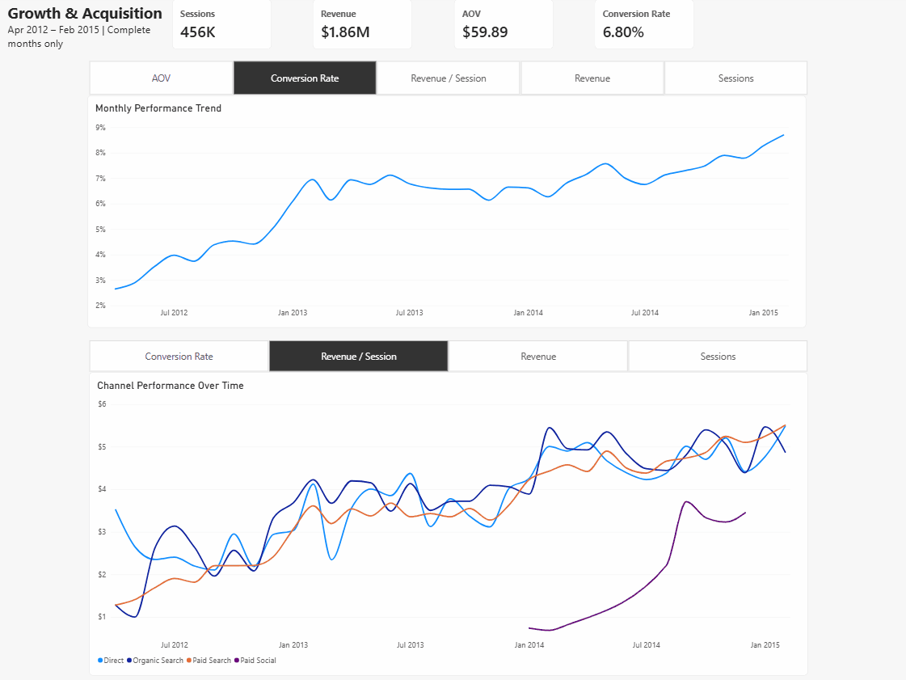
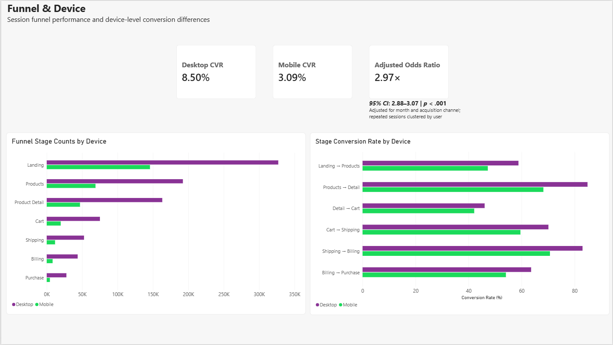
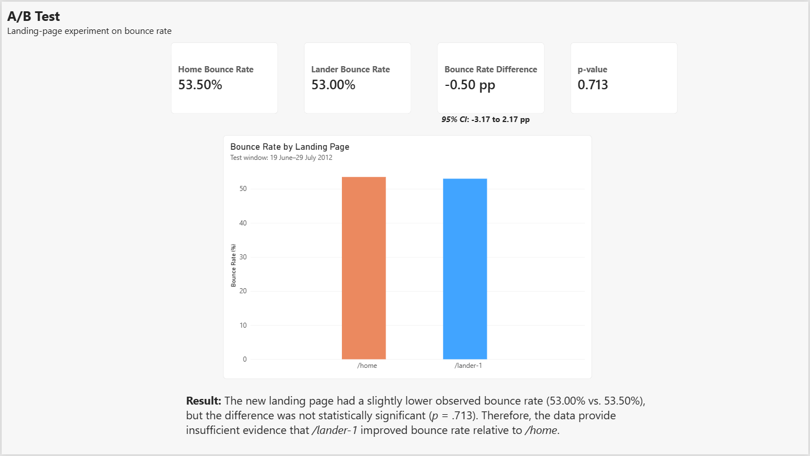

# Maven Fuzzy Factory — E-commerce Analytics

An end-to-end analysis of e-commerce traffic, acquisition channels, conversion funnels, device performance, and a landing-page A/B test using **PostgreSQL, Python, statistical modelling, and Power BI**.

The project combines business-focused exploratory analysis with inferential statistics to examine how the business developed over time, where users leave the purchase funnel, how performance differs by device and acquisition channel, and whether an experimental landing page reduced bounce rate.

---

## Dashboard

### 1. Growth & Acquisition


The Growth & Acquisition page tracks business performance over time and allows users to dynamically switch between:

- Sessions
- Revenue
- Conversion Rate
- Average Order Value
- Revenue per Session

The channel view uses the same interactive approach to compare different types of traffic across **Paid Search, Organic Search, Direct, and Paid Social**.



### 2. Funnel & Device



This page compares progression through the purchase funnel for desktop and mobile sessions and combines descriptive funnel analysis with an adjusted statistical model of purchase conversion.

### 3. A/B Test



The final page evaluates whether a new landing page reduced bounce rate relative to the original homepage.

The complete interactive Power BI report is available in:

```text
powerbi/maven_dashboard.pbix
```

---

## Business Questions

The analysis focuses on five main questions:

1. How did traffic, revenue, conversion, and average order value change as the business grew?
2. How did acquisition channels differ in traffic quality and revenue generation?
3. Where are users most likely to leave the purchase funnel?
4. Is the observed difference between desktop and mobile conversion still present after accounting for time, acquisition channel, and repeated sessions within users?
5. Did the new landing page reduce bounce rate in the A/B test?

---

## Data

The Maven Fuzzy Factory database contains session-, pageview-, order-, product-, and refund-level e-commerce data covering **March 2012 to March 2015**.

The analysis includes approximately:

- **473K website sessions**
- **394K unique users**
- **32K orders**

The analysis uses data from the following source tables:

- `website_sessions`
- `website_pageviews`
- `orders`
- `order_items`
- `order_item_refunds`
- `products`

The first and last months in the dataset, **March 2012 and March 2015**, contain only partial data, so they are excluded from the monthly trend analysis. The analysis covers **April 2012 through February 2015**, when full monthly data are available.

Missing acquisition values in the source data were stored as literal `"NULL"` strings and were handled explicitly during channel classification.

### Revenue definition

Revenue metrics are based on order value and represent **gross revenue before refunds**. Refund data were available in the database but were not included in the current calculations.

---

# Key Findings

## 1. Business growth was accompanied by improving conversion efficiency

Between April 2012 and February 2015:

- monthly sessions increased from approximately **3.7K to 23.8K**
- monthly gross revenue increased from approximately **$4.9K to $129K**
- conversion rate increased from approximately **2.65% to 8.70%**
- average order value increased from approximately **$50 to $62**
- revenue per session increased from approximately **$1.33 to $5.43**

Overall, revenue growth coincided with substantially greater traffic volume, higher conversion rates, and higher average order values.

---

## 2. Acquisition channels differed substantially in performance

Paid Search generated the majority of traffic and gross revenue, while Organic Search and Direct traffic showed somewhat stronger conversion and revenue per session.

| Channel | Sessions | Conversion Rate | Revenue / Session |
|---|---:|---:|---:|
| Paid Search | 378,858 | 6.82% | $4.08 |
| Organic Search | 43,411 | 7.51% | $4.53 |
| Direct | 39,917 | 7.15% | $4.37 |
| Paid Social | 10,685 | 3.21% | $2.08 |

Paid Social showed substantially lower conversion and revenue per session than the other channels.

Advertising-cost data were not available, so these comparisons describe **gross revenue efficiency rather than channel profitability or return on ad spend**.

---

## 3. Product Detail → Cart was the main overall funnel bottleneck

The purchase funnel was reconstructed as:

**Landing → Products → Product Detail → Cart → Shipping → Billing → Purchase**

The lowest stage conversion occurred between **Product Detail and Cart**.

Approximately:

- **46% of desktop sessions**
- **42% of mobile sessions**

that reached a product-detail page progressed to the cart.

More than half of the sessions that reached a product-detail page did not continue to the cart.

Importantly, this was a **general funnel bottleneck rather than a device-specific pattern**. In fact, the Product Detail → Cart transition had the **smallest observed desktop–mobile conversion gap** of all funnel stages.

This makes the Product Detail → Cart transition an area for further investigation. Potential explanations could include product-page clarity, visibility of the add-to-cart action, pricing or shipping information, required product selections, or technical friction.

The available data cannot determine which mechanism is responsible, but the funnel identifies where more targeted behavioral or UX investigation could begin.

---

## 4. Desktop sessions consistently showed higher conversion than mobile

Overall purchase conversion was:

- **Desktop: 8.50%**
- **Mobile: 3.09%**

Desktop sessions converted at a substantially higher rate than mobile sessions overall. The same pattern was visible across every stage of the purchase funnel, although the size of the gap varied between stages.

As noted above, **Product Detail → Cart** was the main overall funnel bottleneck, but it also had the smallest observed desktop–mobile gap. Mobile conversion was lower at every funnel stage, with the largest differences appearing in **Products → Product Detail** and **Shipping → Billing**.

Possible explanations include greater usability or input friction on mobile, differences in browsing context or purchase intent, or other device-related factors. The available data do not distinguish between these explanations.

---

# Device Conversion Model

The database is structured at the **session level**, meaning the same user can appear more than once if they return to the website.

In this dataset:

- **394,318 unique users** generated 472,871 sessions
- **51,270 users (13.0%)** had more than one session
- users generated up to **4 sessions**

Sessions belonging to the same user may be more similar to each other than sessions belonging to different users. A standard logistic regression assumes independent observations, so ignoring this repeated-session structure could produce overly precise uncertainty estimates.

A **Generalized Estimating Equation (GEE)** logistic model was used to estimate the population-level association between device type and purchase conversion while clustering repeated sessions within users.

The adjusted model was:

```text
converted ~ device_type + month + acquisition_channel
```

with:

- binomial outcome distribution
- sessions clustered by `user_id`
- exchangeable within-user correlation structure

Calendar month and acquisition channel were included because the database covers almost three years of changing traffic patterns, and desktop and mobile sessions may not have been distributed identically across time or acquisition sources.

### Results

The unadjusted desktop-versus-mobile odds ratio was approximately:

**OR = 2.91**

After adjustment for calendar month and acquisition channel:

**Adjusted OR = 2.97**  
**95% CI: 2.88–3.07**  
**p < .001**

After accounting for calendar month, acquisition channel, and repeated sessions within users, desktop sessions had approximately **2.97 times the odds of purchase compared with mobile sessions**.

The adjusted estimate was very similar to the unadjusted estimate. Accounting for month and acquisition channel changed the estimated device association very little.

The observed desktop–mobile difference cannot be explained simply by one device receiving traffic in different months or from a substantially different mix of the measured acquisition channels.

Other unmeasured differences between desktop and mobile sessions may still contribute to the association, so the result remains **observational rather than causal**.

The Python analysis also includes:

- observed conversion rates by device
- the unadjusted and adjusted GEE models
- marginal predicted conversion probabilities over time
- graphical comparison of observed and model-adjusted device performance

See:

```text
python/01_device_gee_analysis.ipynb
```

---

# A/B Landing Page Test

The landing-page experiment compared:

- `/home`
- `/lander-1`

with **bounce rate** as the outcome.

A bounced session was defined as a session containing exactly one pageview.

The analysis window was **19 June to 29 July 2012**.

This period was identified from the observed traffic-allocation pattern, beginning when `/lander-1` received concurrent traffic with `/home` and ending before traffic shifted predominantly to the new page.

## Results

| Landing Page | Sessions | Bounce Rate |
|---|---:|---:|
| `/home` | 3,082 | 53.50% |
| `/lander-1` | 2,381 | 53.00% |

The new landing page had an observed bounce rate **0.50 percentage points lower** than the original homepage.

A two-proportion z-test produced:

**Difference: −0.50 pp**  
**95% CI: approximately −3.17 to 2.17 pp**  
**p = .713**

The observed difference was not statistically significant.

The data provide **insufficient evidence that `/lander-1` improved bounce rate relative to `/home`**.

This does not mean that the two landing pages have been shown to perform identically. The confidence interval includes zero and spans effects in both directions, meaning the data are compatible with a modest reduction in bounce rate, little or no difference, or a modest increase in bounce rate.

The experiment did not provide sufficiently precise evidence of an improvement. Demonstrating that two pages are practically equivalent would require defining what size of difference is small enough to be considered unimportant and testing that question explicitly.

---

# Methodology

## SQL

PostgreSQL was used for:

- initial data exploration
- acquisition-channel classification
- monthly aggregation
- session-level funnel reconstruction
- device-level funnel analysis
- extraction of the A/B test sample
- creation of the session-level statistical modelling dataset
- creation of analytics views consumed by Power BI

The funnel was reconstructed using pageview timestamps so that sessions had to progress through stages in chronological order.

The SQL analysis files are available under:

```text
sql/analysis/
```

Power BI support views are defined in:

```text
sql/powerbi/power_bi_views.sql
```

---

## Python

Python was used for the inferential analyses:

- repeated-session diagnostics
- unadjusted and adjusted GEE logistic regression
- odds ratios and confidence intervals
- marginal predicted probabilities
- two-proportion z-test
- confidence interval for the A/B test effect

Main libraries:

- `pandas`
- `NumPy`
- `statsmodels`
- `matplotlib`

The two notebooks are:

```text
python/01_device_gee_analysis.ipynb
python/02_ab_test_analysis.ipynb
```

---

## Power BI

Power BI was used to build the final three-page interactive report.

The report includes:

- KPI cards
- monthly performance trends
- channel performance trends
- dynamic metric selection using field parameters
- device funnel comparisons
- stage conversion analysis
- statistical-model results
- A/B test results
- custom tooltips

---

# Tools

- **PostgreSQL**
- **SQL**
- **Python**
- **pandas**
- **NumPy**
- **statsmodels**
- **matplotlib**
- **Power BI**
- **DAX**

---

# Repository Structure

```text
maven-fuzzy-factory-analysis/
│
├── README.md
├── .gitignore
│
├── sql/
│   ├── analysis/
│   │   ├── 01_monthly_trends.sql
│   │   ├── 02_channel_analysis.sql
│   │   ├── 03_funnel_analysis.sql
│   │   ├── 04_device_model_dataset.sql
│   │   └── 05_ab_test.sql
│   │
│   └── powerbi/
│       └── power_bi_views.sql
│
├── python/
│   ├── 01_device_gee_analysis.ipynb
│   └── 02_ab_test_analysis.ipynb
│
├── powerbi/
│   └── maven_dashboard.pbix
│
└── images/
    ├── gif01_growth_acquisition_interactive.gif
    ├── images01_growth_acquisition.png
    ├── images02_funnel_device.png
    └── images03_ab_test.png
```

The large session-level modelling dataset is not included in the repository. It can be regenerated using the provided SQL extraction script.

---

# Limitations

**Refunds were not incorporated into revenue metrics.** Reported revenue and revenue-per-session values represent gross order revenue rather than net realized revenue.

**Channel costs were unavailable.** Channel comparisons cannot be interpreted as profitability or return on advertising spend.

**The device analysis is observational.** Although the GEE model adjusts for calendar month and acquisition channel and accounts for repeated sessions within users, other differences between desktop and mobile sessions may remain unmeasured.

**The funnel identifies where users leave but not why.** Lower conversion at a particular stage identifies an area for further investigation but does not establish the source of the friction.

**The A/B test did not provide evidence of improvement.** The observed effect was small and the confidence interval included both possible improvement and possible worsening.

---

# Possible Extensions

Potential next steps include:

- incorporating refunds to compare gross and net revenue
- analysing refund rates by product or acquisition channel
- investigating individual product performance
- examining repeat-customer behaviour
- exploring potential sources of mobile funnel friction
- experimentally testing targeted mobile UX improvements
